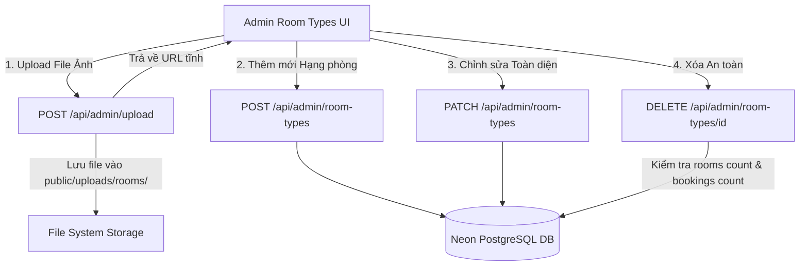

# Kế Hoạch Triển Khai Quản Lý Hình Ảnh & Thêm/Sửa/Xóa Hạng Phòng (Room Types CRUD)

> **Dự án:** Song Ngọc Homestay Management System
> **Mục tiêu:** Cho phép tải lên & thay đổi hình ảnh của từng hạng phòng, triển khai trọn vẹn nghiệp vụ Thêm - Sửa - Xóa Hạng phòng (Room Types) kèm kiểm tra ràng buộc an toàn dữ liệu và đồng bộ định dạng giao diện quản trị.

---

## 1. Bối cảnh & Hiện trạng
1. **Hình ảnh phòng (`RoomType.images`)**:
   - Hiện tại `images` được lưu dưới dạng chuỗi JSON `string[]` trong CSDL Prisma (`RoomType.images`), tuy nhiên trên giao diện quản trị `/admin/room-types` chưa có tính năng hiển thị ảnh, chưa có tải ảnh từ máy tính (upload) và chưa có xóa/đổi ảnh.
   - API `PATCH /api/admin/room-types` hiện tại bỏ qua trường `images`, không cho cập nhật ảnh.
2. **Nghiệp vụ Hạng phòng (Room Types)**:
   - Trang `/admin/room-types` hiện chỉ có form sửa giá cơ bản, thiếu hoàn toàn nút **"+ Thêm hạng phòng"** và nút **"Xóa"**.
   - API `/api/admin/room-types/route.ts` chỉ có `GET` và `PATCH` cục bộ, thiếu `POST` (tạo mới) và thiếu `DELETE` (xóa có ràng buộc quan hệ).
   - Ràng buộc an toàn CSDL: Model `Room` và `Booking` có quan hệ `onDelete: Restrict` với `RoomType`. Nếu xóa một hạng phòng đang có phòng thực tế hoặc đơn đặt phòng sẽ gây lỗi Foreign Key, do đó cần chặn xóa và đưa ra thông báo hướng dẫn quản trị viên chuyển sang trạng thái "Tạm ngưng kinh doanh".

---

## 2. Kiến trúc & Thiết kế Kỹ thuật

### 2.1. API Upload Ảnh (`POST /api/admin/upload`)
- Nhận `FormData` với file ảnh (hỗ trợ `image/jpeg`, `image/png`, `image/webp`, `image/gif`).
- Kiểm tra dung lượng tối đa 5MB.
- Lưu trữ vào thư mục tĩnh `public/uploads/rooms/` (tự động tạo thư mục nếu chưa tồn tại).
- Tạo tên file ngẫu nhiên an toàn: `room-${Date.now()}-${crypto.randomBytes(4).toString('hex')}.${ext}`.
- Trả về URL nội bộ: `/uploads/rooms/${fileName}`.
- Cho phép quản trị viên tải ảnh từ máy tính HOẶC dán link ảnh trực tuyến (Unsplash, CDN...).

### 2.2. API CRUD Hạng phòng (`/api/admin/room-types`)
- **`POST /api/admin/room-types`**:
  - Phân quyền: Yêu cầu quyền `rooms:manage`.
  - Dữ liệu tiếp nhận: `name`, `slug`, `basePrice`, `weekendPrice`, `hourlyPrice`, `maxAdults`, `maxChildren`, `bedType`, `roomArea`, `amenities` (mảng string), `images` (mảng string), `description`, `isActive`.
  - Tự động sinh `slug` chuẩn SEO (bỏ dấu tiếng Việt, lowercase, nối dấu `-`) nếu người dùng không nhập hoặc để trống.
  - Kiểm tra trùng lặp `slug` trước khi tạo.
- **`PATCH /api/admin/room-types`**:
  - Mở rộng xử lý cập nhật thêm: `images`, `amenities`, `slug`, `roomArea`, `bedType`, `description`, `isActive`.
- **`DELETE /api/admin/room-types/[id]`**:
  - Phân quyền: Yêu cầu quyền `rooms:manage`.
  - Kiểm tra `db.room.count({ where: { roomTypeId: id } })`: Nếu > 0, từ chối xóa với mã lỗi 400 kèm giải thích: *"Không thể xóa hạng phòng này vì đang có X phòng thực tế liên kết. Vui lòng chuyển các phòng sang hạng khác hoặc tạm ngưng kinh doanh."*
  - Kiểm tra `db.booking.count({ where: { roomTypeId: id } })`: Nếu > 0, từ chối xóa với mã lỗi 400 kèm giải thích: *"Không thể xóa hạng phòng này vì đang có X đơn đặt phòng lịch sử."*
  - Nếu thỏa mãn: Thực hiện xóa an toàn `db.roomType.delete({ where: { id } })`.

### 2.3. Modal Quản lý Hạng phòng (`RoomTypeModal.tsx`)
- Tách riêng component `src/components/admin/RoomTypeModal.tsx`:
  - **Khu vực Quản lý Hình ảnh**:
    - Danh sách ảnh dạng lưới (thumbnails grid).
    - Nút đặt làm ảnh đại diện (đưa ảnh lên vị trí đầu tiên `[0]`).
    - Nút xóa từng ảnh với icon thùng rác.
    - Nút bấm tải ảnh từ máy tính: `input type="file" accept="image/*"` kích hoạt gọi API `/api/admin/upload` tự động.
    - Ô nhập link ảnh trực tiếp (Dán URL) + Nút `+ Thêm link` để thêm ảnh từ Unsplash/CDN.
  - **Bộ chọn Tiện nghi (Amenities Selector)**:
    - Danh sách tiện nghi chọn nhanh (badges): Wifi (`wifi`), Máy lạnh (`air_con`), Smart TV (`tv_smart`), Nước nóng (`hot_water`), Ban công (`balcony`), Tủ lạnh mini (`fridge`), Máy sấy tóc (`hairdryer`), Ấm siêu tốc (`kettle`), Bàn làm việc (`desk`), Két an toàn (`safe_box`).
    - Cho phép gõ thêm tiện nghi tùy biến.
  - **Cấu hình Bảng giá & Thông số**:
    - Giá ngày thường, giá cuối tuần (T6-T7), giá theo giờ (2h đầu).
    - Sức chứa (Người lớn, Trẻ em), Loại giường, Diện tích phòng (m²).
    - Mô tả chi tiết hạng phòng & Checkbox mở bán.

### 2.4. Nâng cấp Giao diện `/admin/room-types/page.tsx`
- Bổ sung nút **"+ Thêm hạng phòng"** trên Action Header (`.admin-action-header`).
- Bổ sung hình ảnh đại diện (cover thumbnail) ở đầu mỗi Card hạng phòng + badge số lượng ảnh (ví dụ: `📷 4 ảnh`).
- Bổ sung nút **"Xóa"** bên cạnh nút **"Chỉnh sửa"** trên từng Card.
- Modal xác nhận xóa an toàn (Confirm Dialog).

---

## 3. Các Bước Triển Khai Chi Tiết

- [ ] **Task 48: API Upload Ảnh (`POST /api/admin/upload`)**
  - Tạo file `src/app/api/admin/upload/route.ts` xử lý multipart/form-data.
  - Kiểm tra định dạng ảnh (jpg, png, webp, gif) và dung lượng (< 5MB).
  - Ghi file vào `public/uploads/rooms/` và trả về URL ảnh.

- [ ] **Task 49: Backend API CRUD Hạng phòng**
  - Bổ sung hàm `POST` tạo mới hạng phòng vào `src/app/api/admin/room-types/route.ts`.
  - Mở rộng hàm `PATCH` cập nhật đầy đủ các trường `images`, `amenities`, `slug` trong `src/app/api/admin/room-types/route.ts`.
  - Tạo file `src/app/api/admin/room-types/[id]/route.ts` xử lý `DELETE` kèm kiểm tra ràng buộc toàn vẹn dữ liệu.

- [ ] **Task 50: Xây dựng Component `RoomTypeModal.tsx`**
  - Tạo file `src/components/admin/RoomTypeModal.tsx` phục vụ cả hai chế độ Thêm mới & Chỉnh sửa.
  - Tích hợp tính năng quản lý mảng ảnh (Upload file, thêm link, xóa ảnh, đặt ảnh đại diện).
  - Tích hợp bộ chọn tiện nghi badges tiện lợi.

- [ ] **Task 51: Nâng cấp Trang `/admin/room-types/page.tsx`**
  - Tích hợp nút "+ Thêm hạng phòng", nút "Xóa" kèm Confirm Dialog.
  - Hiển thị ảnh cover và số lượng ảnh trên từng thẻ hạng phòng.
  - Tích hợp `useToast()` phản hồi trực quan.

- [ ] **Task 52: Kiểm thử, Type Check & Nghiệm thu**
  - Viết test suite `tests/room-types-crud.test.ts`.
  - Chạy `npm run check:rules`, `npm run check:types`, `npx vitest run`.
  - Cập nhật checklist `task.md`.
